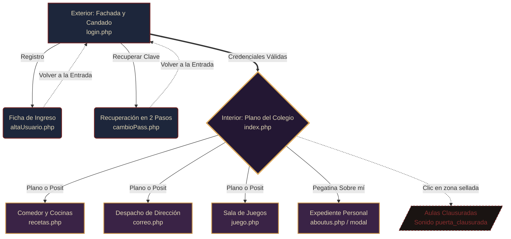

# Mapa del Sitio (Sitemap) - DAWlloween

Estructura de navegación de la aplicación, desde la cancela exterior de acceso hasta las estancias interiores del colegio.

### Resumen de Rutas

* **Nivel 0 (Autenticación - Acceso Público):**
  * `pages/login.php`: Fachada exterior interactiva con candado y validación de sesiones.
  * `pages/altaUsuario.php`: Registro de nuevo alumno sobre folio A4 de expediente institucional (`folio_expediente_a4.png`).
  * `pages/cambioPass.php`: Flujo en 2 pasos para recuperar la contraseña mediante respuesta secreta sobre folio A4 de expediente.
* **Nivel 1 (Hub Principal - Requiere Sesión):**
  * `index.php`: Plano arquitectónico general con linterna, bombilla de sala, posit de índice y panel de accesibilidad.
* **Nivel 2 (Dependencias Operativas - Requiere Sesión):**
  * `pages/recetas.php`: Comedor escolar con recetario temático de Halloween y lámpara fluorescente.
  * `pages/correo.php`: Despacho de dirección con máquina de escribir analógica y correspondencia exterior vía SMTP ([correo.md](correo.md)).
  * `pages/juego.php`: Sala de juegos recreativa con minijuego 2D (en desarrollo).
  * `pages/aboutus.php`: Expediente y biografía del creador (accesible como modal o vista dedicada).
